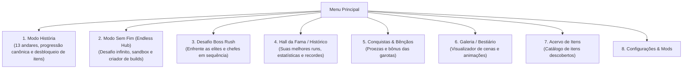

# Planejamento Completo de Expansão: MGE Deluxe

Este documento reúne todas as novas funcionalidades planejadas para o *Monster Girl Encounters*, detalhando mecânicas, fluxo de telas, arquitetura técnica e produção de assets.

---

## 1. Fluxo Geral dos Modos de Jogo no Menu Principal

O jogo passa a ter divisões claras logo na tela inicial, separando a narrativa da experimentação sandbox e dos desafios adicionais:

---

## 2. Hub do Modo Sem Fim (*Endless Hub*)

Ao clicar em **Modo Sem Fim**, o jogador acessa um menu exclusivo:

1. **Jornada Clássica Sem Fim (*Standard Endless Run*):**
   - Inicia com 10 Ouro e a escolha de 1 item básico entre 3.
   - Dificuldade escala infinitamente a cada ciclo de 13 andares ($5^{\text{loop}}$).
   - Ideal para quem quer testar sua capacidade de sobreviver e acumular fortuna a partir do zero.
2. **Criador de Builds (*Sandbox Loadout*):**
   - **Mochila Viva:** Começa na grade 4x4 padrão. Se o jogador equipar itens como *Bolsa Espaçosa* (`spacious_bag`), *Gosma Ectoplásmica* (`ectoplasmic_slime`) ou *Amuleto da Avareza* (`amulet_of_avarice`), o script executa `tilesHolder.addRow()` imediatamente, abrindo novas linhas na hora para expandir a build!
   - **Catálogo de Itens:** Lista todos os itens do Acervo (com opção de "Modo Livre Total" para testar itens ainda não vistos).
   - **Ouro Inicial Configurável:** 10 G (Padrão), 1.000 G, 50.000 G, 999.999 G ou valor personalizado.
   - **Códigos de Build (*Build Sharing*):** Copiar e colar códigos de texto da build via área de transferência (Windows e Android).
3. **Continuar Partida Salva:**
   - Retoma a última partida sem fim salva no checkpoint de mapa.

---

## 3. Desafio "Boss Rush" (Batalha Contínua)

- **Estrutura:**
  - Enfrenta apenas as garotas mais poderosas em sequência contínua:
    1. *Esfinge (Elite)*
    2. *Succubus (Elite)*
    3. *Fadas (Chefe Final)*
    4. *Versões Fortalecidas em Ciclos Infinitos*
  - Entre cada batalha, o jogador visita uma **Loja Rápida** com 3 rerrolls gratuitos e ouro extra de recompensa para ajustar a build na hora.
  - Modo acelerado e perfeito para jogatinas rápidas.

---

## 4. Sistema de Ascensão / Pactos de Desafio

Antes de iniciar uma run (no Modo História ou no Modo Sem Fim), o jogador pode ativar modificadores de dificuldade que multiplicam a pontuação e liberam recompensas exclusivas:

| Pacto | Efeito | Grau de Desafio |
| :--- | :--- | :--- |
| **Pacto da Fome** | O EPP exigido pelas garotas cresce +20% por andar. | Nível 1 |
| **Inflação da Aranha** | Todos os itens e rerrolls da loja custam +50% de ouro. | Nível 1 |
| **Mochila Rasgada** | O jogador inicia a partida com 1 linha a menos de espaço. | Nível 2 |
| **Olhar Hipnótico** | Batalhas de Elite aparecem com frequência dobrada. | Nível 2 |
| **Frenesi Selvagem** | As garotas ganham um pulso que anula temporariamente itens adjacentes. | Nível 3 |

---

## 5. Histórico de Runs e Hall da Fama (*Run History*)

Armazena as últimas 10 partidas e o recorde histórico do jogador:
- **Snapshot Visual da Mochila:** Mostra a grade exata com os itens usados no momento do fim da run.
- **Estatísticas Registradas:** Andar alcançado, maior EPP em um único pump, ouro acumulado, semente utilizada e data.
- **Botão "Reviver Build":** Importa a build daquela run histórica diretamente para o Criador de Builds com um clique.

---

## 6. Conquistas & Bênçãos das Garotas Monstro

### 6.1. Conquistas com Recompensas
- *"Toque de Midas":* Acumular 100.000 de Ouro (Recompensa: Nova paleta cosmética de mochila).
- *"Nas Profundezas":* Alcançar o andar 50 no Modo Sem Fim (Recompensa: Título "Mestre das Cavernas").
- *"Minimalista":* Vencer o Modo História com 6 itens ou menos na mochila.
- *"Sobrecarga":* Atingir 10.000.000 de EPP em um único pump.

### 6.2. Bênçãos de Afinidade (*Monster Girl Blessings*)
Conforme você derrota garotas monstro repetidamente ou as agrada com seus itens favoritos, desbloqueia **Bênçãos Ativas** para equipar antes de qualquer partida:
- **Bênção da Succubus:** +10% de EPP por item de ouro ou joia na mochila.
- **Bênção da Onikuma:** Inicia toda batalha de elite com +1 Escudo.
- **Bênção da Slime:** Itens do subtipo *Gosma* ativam duas vezes por pump.
- **Bênção da Goblin:** Inicia as partidas com +30 de ouro extra.

---

## 7. Novos Itens / Relíquias Sinergéticas & Produção de Assets

### 7.1. Como os Itens Serão Estruturados
O jogo já possui **76 itens originais**, todos com sinergias ricas de multiplicadores, adjacência e contadores. As novas relíquias entram para expandir essas possibilidades:
1. **Espelho Mágico (Joia):** Clona o efeito do item espelhado no lado oposto da linha.
2. **Ampulheta Ancestral (Relíquia):** Faz itens adjacentes ativarem 2 vezes por pump.
3. **Ímã de Ouro (Metal):** Atrai o valor de todas as moedas na mochila e concede multiplicador global.
4. **Poção Camaleão (Elixir):** A cada 5 andares, transforma-se em um item de raridade superior.
5. **Bolsa Dimensional:** Abre 1 slot especial isolado na lateral da mochila.

### 7.2. Padrão Técnico de Assets (Sprites 36x36 Pixel Art)
- **Dimensões:** Exatamente **36 x 36 pixels** por ícone.
- **Formato:** PNG indexado de 4 a 5 cores (paleta retrô com tons escuros de carmim, carvão, lilás e creme), combinando 100% com os 76 itens originais de `data/sprites/items/`.
- **Produção:**
  - *Itens Nativos:* Utilizam integralmente as 76 sprites originais do jogo.
  - *Novos Itens:* Gerados programaticamente via scripts Python (com a biblioteca Pillow) para manter a paleta exata, dithering 1-bit e estilo visual autêntico do jogo.
  - *Interfaces e Menus (Boss Rush, Conquistas, Histórico):* Reaproveitam as artes existentes das garotas monstro (`succubus.png`, `sphinx.png`, `fairies.png`, etc.) e a UI nativa, sem necessidade de pacotes externos.
